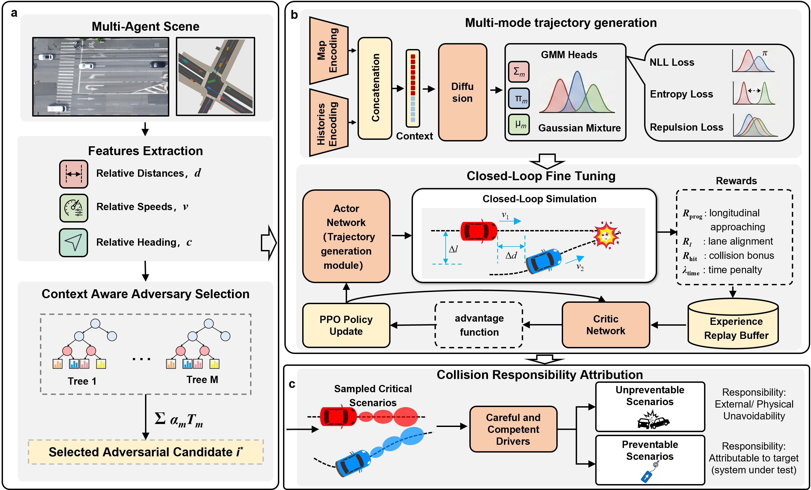
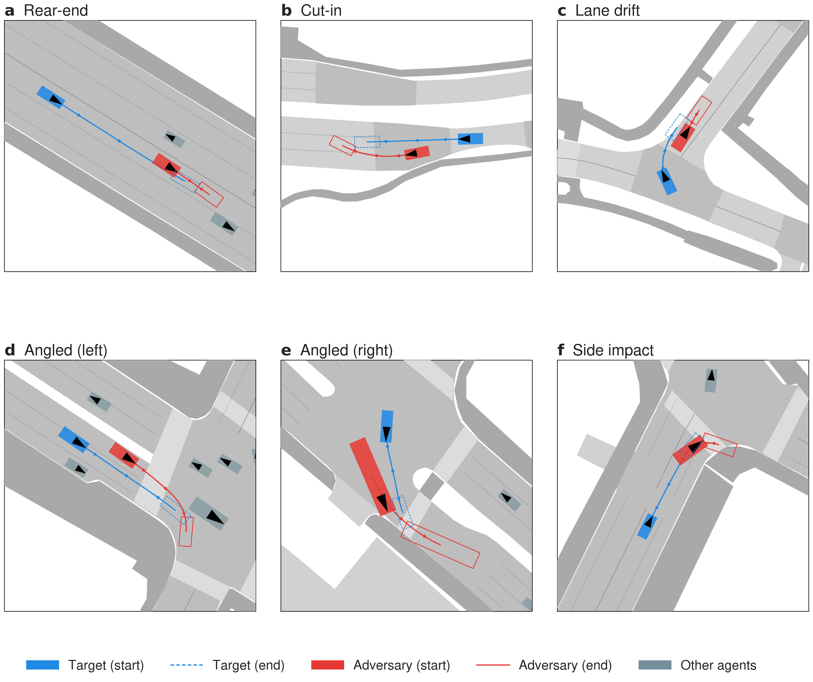

# CARS: Learning Responsibility-Attributed Adversarial Scenarios for Testing Autonomous Vehicles

<p align="center">
  
</p>

<p align="center">
  <a href="https://robosafe-lab.github.io/CARS">Project page</a>
  ·
  <a href="https://huggingface.co/Visier-1/cars-checkpoints">Checkpoints (HF)</a>
</p>

## Overview

**CARS** generates *responsibility-attributed* safety-critical scenarios for
autonomous-vehicle testing. Given a driving scene, CARS picks a target ego
agent, a context-aware adversary, and drives a learned adversarial policy so
that the adversary forces the target into a collision **only when the target
is at fault** — i.e., when a reference safe-driver model would not have been
able to avoid the collision. Three modules:

1. **Adaptive adversary selection** — a gradient-boosted decision tree picks
   the most threatening neighbour, with a step-confirmation gate to suppress
   high-frequency switching.
2. **Trajectory generation** — Gaussian-Mixture Diffusion (GMD) policy,
   PPO-fine-tuned, samples multi-modal adversarial trajectories.
3. **Responsibility attribution** — three reference responsibility models
   (FSM and CC-JP-LaneAware from UN R157; RSS from Mobileye) re-evaluate
   every collision; only target-attributable cases are kept.

The framework is trained on nuScenes. AD4CHE and RounD rollouts are
supported as optional cross-dataset runs.

<p align="center">
  
</p>

## Environment Setup

### Option A — Docker (canonical)

```bash
docker build -t cars-code .

docker run --gpus all -it --rm \
  -v "$PWD":/workspace \
  -v /path/to/nuscenes:/nuscenes \
  -v /path/to/AD4CHE:/AD4CHE \
  -v /path/to/rounD/rounD:/rounD/rounD \
  -v /path/to/cld_cache:/cld_cache \
  -w /workspace \
  cars-code bash
```

### Option B — Conda (local install)

```bash
conda env create -f environment.yml
conda activate cars
pip install --no-deps l5kit kornia==0.6.4 shapely pyemd POT
pip install --no-deps -e CTG -e trajdata -e Pplan
```

The five `--no-deps` packages and the three vendored editable installs
must skip pip's auto-dep resolution: their declared dependencies would
otherwise upgrade `numpy 1.21.5` (and friends) and break the pinned stack.

Outside Docker, place each dataset next to the repo (matching the
`../<dataset>` paths in `configs/`), or edit the relevant
`configs/simulation_config*.json`.

## Datasets

CARS is trained and primarily evaluated on **nuScenes**. Download
`v1.0-trainval` plus the **v1.3 map expansion pack** from
<https://www.nuscenes.org/nuscenes>, and place the result next to the repo:

```
nuscenes/
├── v1.0-trainval/    scene / annotation JSONs
├── maps/             vector + semantic maps (incl. v1.3 expansion)
├── samples/          sensor data — not used
└── sweeps/           sensor data — not used
```

Configs expect `../nuscenes` relative to the repo root; edit
`dataset_path` and `trajdata.trajdata_data_dirs` in
`configs/simulation_config*.json` if your install lives elsewhere.

AD4CHE (Stage 3 `ad4che`) and rounD (Stage 3 `round`) are optional
cross-dataset runs; obtain them from their providers and place them at
`../AD4CHE` and `../rounD/rounD` if used.

## Checkpoints

The repository ships with the small artifacts (decision trees + the policy
architecture dump) so the code is runnable end-to-end after a single
download of the two large `.ckpt` files from Hugging Face Hub.

| File                                  | Source       | Size    |
|---------------------------------------|--------------|---------|
| `checkpoints/decision_tree_model.pkl` | bundled      | 2.0 MB  |
| `checkpoints/round_decision_tree.pkl` | bundled      | 1.5 MB  |
| `checkpoints/config.json`             | bundled (Stage 1 architecture dump) | 7.7 KB  |
| `checkpoints/g8.ckpt`                 | Hugging Face | 223 MB  |
| `checkpoints/cars_adversary.ckpt`     | Hugging Face | 119 MB  |
| `checkpoints/ctg.ckpt`                | Hugging Face (only needed for `baselines ctg`) | 259 MB |
| `checkpoints/ctg_config.json`         | Hugging Face (CTG architecture dump) | 14 KB |

Download all checkpoints into `checkpoints/` before running any stage
that loads them:

```bash
hf download Visier-1/cars-checkpoints --local-dir checkpoints/
```

Repo: <https://huggingface.co/Visier-1/cars-checkpoints>.

## Repository Layout

```
configs/        Entry-point JSON configs
labels/         Ground-truth (tgt, adv) labels for AD4CHE / RounD
checkpoints/    Decision-tree pickles + downloaded model checkpoints
scripts/        Code (4 sub-packages + 2 top-level entry scripts)
CTG/  trajdata/  Pplan/       Vendored dependencies
Dockerfile
```

## Pipeline Overview

CARS follows a four-stage pipeline:

| Stage | Description                                                       | Entry point                                |
|------:|-------------------------------------------------------------------|--------------------------------------------|
|     1 | Train the Gaussian-mixture diffusion policy on nuScenes           | `python scripts/gmm_training.py`           |
|     2 | Fine-tune the adversarial policy with PPO                         | `python scripts/ppo.py`                    |
|     3 | Generate adversarial scenarios on a target dataset                | `python -m scripts.rollout <subcmd>`       |
|     4 | Re-evaluate rollouts and extract per-run summary metrics          | `python -m scripts.evaluate <subcmd>`      |

Configuration files live under `configs/`:

| File                                    | Used by                                |
|-----------------------------------------|----------------------------------------|
| `configs/gmm_config.json`               | Stage 1                                |
| `configs/simulation_config.json`        | Stage 2 + Stage 3 (nuScenes)           |
| `configs/simulation_config_ad4che.json` | Stage 3 (AD4CHE)                       |
| `configs/simulation_config_round.json`  | Stage 3 (RounD)                        |
| `configs/simulation_config_ctg.json`    | Stage 3 — CTG drives the target        |

Each `simulation_config*.json` defines three model roles in one file:
`ckpt.policy` (target controller), `ckpt.planner` (adversary), and
`ckpt.predictor` (other agents).

---

## Stage 1 — GMM training

```bash
python scripts/gmm_training.py --config_file configs/gmm_config.json
```

Writes `config.json` and `.ckpt` files under
`<root_dir>/<name>/<version>/` (set in your training config). Stage 2 / 3
load both from `ckpt.policy.ckpt_dir` in `configs/simulation_config.json`
(defaults to `checkpoints/`) — copy them there, or update the path.

## Stage 2 — PPO training

Fine-tunes the adversarial policy on top of the Stage 1 checkpoint:

```bash
python scripts/ppo.py --config_file configs/simulation_config.json
```

Writes a fine-tuned `.ckpt` (the CARS adversary used in Stage 3) to the
results directory specified by the config. Point
`ckpt.planner.ckpt_key` in `configs/simulation_config.json` at this new
checkpoint to use it for rollout.

## Stage 3 — Adversarial rollout

Three datasets are supported. **nuScenes** is the in-distribution case;
**AD4CHE** and **RounD** are re-normalised generalisation cases — the same
nuScenes-trained CARS adversary is reused; only the per-dataset decision
tree and normalisation statistics change.

```bash
python -m scripts.rollout <subcmd> [options]
```

| Subcommand | Description                                                       |
|------------|-------------------------------------------------------------------|
| `nusc`     | nuScenes closed-loop CARS rollout                                 |
| `ad4che`   | AD4CHE highway cross-dataset rollout                              |
| `round`    | RounD roundabout cross-dataset rollout                            |

Examples:

```bash
python -m scripts.rollout nusc   --config_file configs/simulation_config.json
python -m scripts.rollout ad4che --config_file configs/simulation_config_ad4che.json
python -m scripts.rollout round  --config_file configs/simulation_config_round.json
```

Per-subcommand help: `python -m scripts.rollout <subcmd> --help`. The
first AD4CHE invocation auto-builds a trajdata cache (~1-2 min); pass
`--rebuild_cache` to force a rebuild.

### Adversary selection module

```bash
python -m scripts.decision_tree nusc   --config_file configs/simulation_config.json
python -m scripts.decision_tree round  --rec 07
python -m scripts.decision_tree ad4che --runtime_compat
```

### Baselines

Adversary-generation methods CARS is compared against in the paper.
`Bezier-CAT` is provided in this repo; `SafeSim` and `STRIVE` are external.

```bash
python -m scripts.baselines bezier --config_file configs/simulation_config.json
```

- **SafeSim** — <https://github.com/jxmmy7777/safe-sim>
- **STRIVE** — <https://github.com/nv-tlabs/STRIVE>

### Ablation study

ADS-planner robustness: the CARS adversary is held fixed and only the
target-side planner is replaced. The `ctg` entry swaps in the CTG planner.

```bash
python -m scripts.baselines ctg --config_file configs/simulation_config_ctg.json
```

## Stage 4 — Metrics

All evaluation utilities share one entry point with four subcommands:

```bash
python -m scripts.evaluate <subcmd> [options]
```

| Subcommand   | Input                   | Purpose                                                                                 |
|--------------|-------------------------|-----------------------------------------------------------------------------------------|
| `replay`     | rollout HDF5            | Re-simulate every collision episode under FSM, CC-JP-LaneAware, and RSS; record per-model verdict (preventable vs. unpreventable) and criticality metrics in `replay_results_laneaware.csv` |
| `kinematics` | rollout HDF5            | Compute per-episode adversary kinematic-realism metrics (accel / jerk / lateral) and write `kinematics.csv`                                  |
| `aggregate`  | one or more replay CSVs | Aggregate per-run summary metrics from the replay CSV (collision rate, criticality distribution, per-model unpreventable rate, etc.)        |
| `triggers`   | one or more replay CSVs | Per-model breakdown of which mechanism (`BD+` braking deficit / `CFS ≥ 0.9` / `TTC < 1 s`) caused each unpreventable episode               |

Typical workflow for one rollout directory `<run>/` (containing `data.hdf5`):

```bash
# 1. Re-evaluate every collision with FSM / CC-JP-LaneAware / RSS
python -m scripts.evaluate replay \
    --hdf5_path <run>/data.hdf5 \
    --output_dir <run>/replay_results/

# 2. Compute adversary kinematic-realism metrics
python -m scripts.evaluate kinematics \
    --hdf5 <run>/data.hdf5 \
    --output_dir <run>/replay_results/

# 3. Aggregate per-run summary metrics
python -m scripts.evaluate aggregate \
    --runs <run> \
    --labels "CARS"

# 4. Trigger-mechanism breakdown for unpreventable episodes
python -m scripts.evaluate triggers \
    --runs <run> \
    --labels "CARS"
```

Per-subcommand help: `python -m scripts.evaluate <subcmd> --help`.

---

## Citation

If you use CARS in your research, please cite:

```bibtex
@article{xiao_cars,
  title  = {Learning Responsibility-Attributed Adversarial Scenarios for
            Testing Autonomous Vehicles},
  author = {Xiao, Yizhuo and Yan, Haotian and Wang, Ying and Zhu, Zhongpan and
            Zhang, Yuxin and Yan, Xintao and Erden, Mustafa Suphi and
            Wang, Cheng},
  year   = {2026},
  url    = {https://arxiv.org/abs/2605.13751}
}
```

## Acknowledgements

The code builds on the
[CTG / tbsim](https://github.com/NVlabs/traffic-behavior-simulation)
framework, the [trajdata](https://github.com/NVlabs/trajdata) multi-dataset
loader, and a vendored Pplan spline-planning utility — all retained under
their original licences.

## License

Apache 2.0. See [`LICENSE`](LICENSE).
